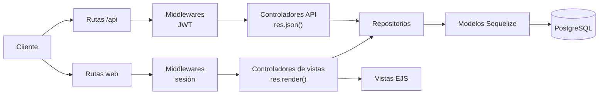
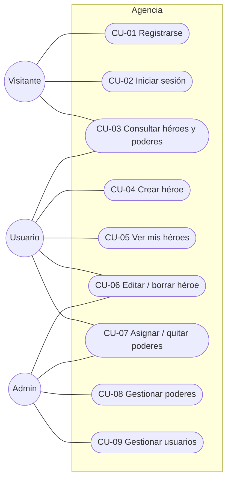
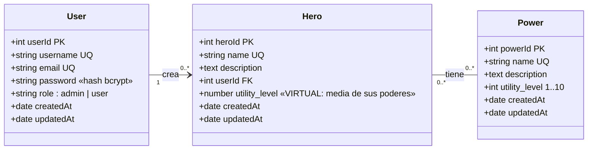
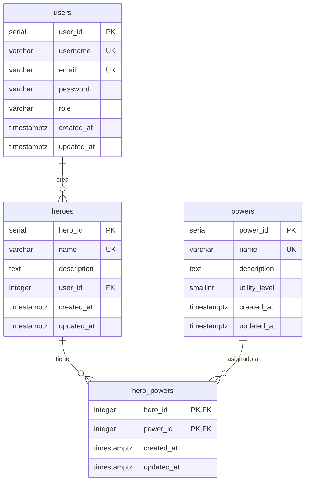
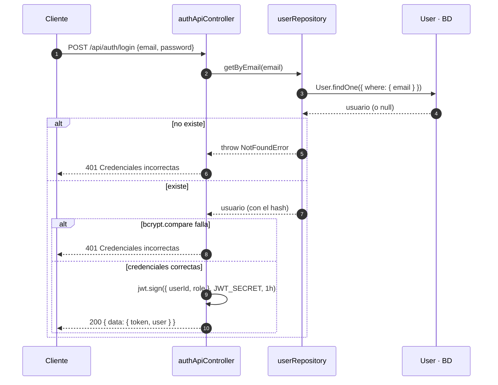
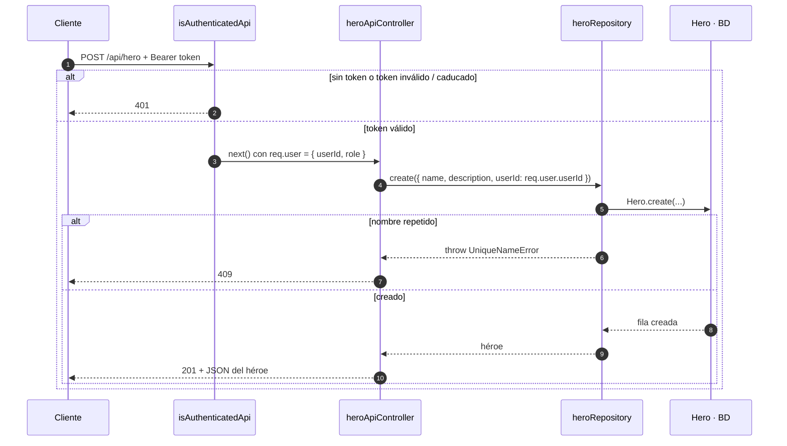
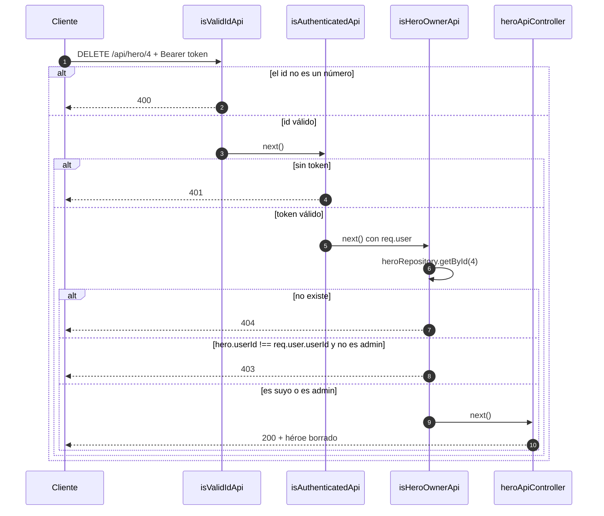

# Agencia de Superhéroes de Segunda — Memoria técnica

## Índice

1. [Contexto y objetivos](#1-contexto-y-objetivos)
2. [Tecnologías y arquitectura](#2-tecnologías-y-arquitectura)
3. [Análisis de requisitos](#3-análisis-de-requisitos)
4. [Casos de uso y permisos](#4-casos-de-uso-y-permisos)
5. [Diagrama de clases y modelo de datos](#5-diagrama-de-clases-y-modelo-de-datos)
6. [Diseño de la API REST y rutas web](#6-diseño-de-la-api-rest-y-rutas-web)
7. [Flujos principales](#7-flujos-principales)
8. [Plan de desarrollo](#8-plan-de-desarrollo)

---

## 1. Contexto y objetivos

La Agencia de Superhéroes de Segunda es una aplicación web para registrar héroes con poderes poco espectaculares pero muy útiles en el día a día: Capitán Wifi, Doctor Cargador o Señora Táper. Cualquier persona puede consultar el catálogo; los usuarios registrados crean sus propios héroes y les asignan poderes; el administrador mantiene el catálogo de poderes y los usuarios.

La gracia del dominio es que una misma persona puede tener varias identidades secretas: un usuario puede ser a la vez Capitán Wifi entre semana y El Fantasma del Trastero los sábados. Cada poder tiene un nivel de utilidad del 1 al 10, y el nivel de utilidad de un héroe es **la media de sus poderes**.

### Objetivos didácticos

El proyecto es pequeño a propósito (3 entidades) pero cubre los conceptos principales del backend:

- **Arquitectura MVC + repositorios**: rutas → middlewares → controladores → repositorios → modelos, con vistas EJS y API REST compartiendo los mismos repositorios.
- **Relación 1:N**: un usuario crea muchos héroes.
- **Relación N:M**: un héroe tiene muchos poderes y un poder lo tienen muchos héroes.
- **Campo calculado**: el nivel de utilidad del héroe es un campo `VIRTUAL` de Sequelize.
- **Gestión de errores**: clases de error con código HTTP (`NotFoundError`, `ForbiddenError`…) que lanzan los repositorios y traducen los controladores.
- **Autenticación**: contraseñas cifradas con bcrypt; sesión en la web y JWT en la API.
- **Autorización**: por rol (solo el admin gestiona poderes y usuarios) y por propiedad (solo el creador o el admin modifica un héroe).
- **Listados**: filtro por poder y paginación.

### Alcance

Dentro: gestión de usuarios, héroes y poderes; asignación de poderes a héroes; registro y login; permisos por rol y propiedad; filtro y paginación del listado de héroes; vistas web sencillas y API REST JSON.

Fuera (posibles ampliaciones): incidentes y misiones, subida de imágenes, búsqueda por texto, tests automáticos y despliegue.

---

## 2. Tecnologías y arquitectura

La aplicación es un único servidor Express que sirve dos interfaces (web con EJS y API REST en `/api`) sobre la misma lógica de acceso a datos. Todo el entorno (aplicación y base de datos) se levanta con Docker Compose.

| Pieza | Tecnología |
| --- | --- |
| Entorno | Node.js 20 (módulos ES) |
| Servidor | Express 5 |
| Base de datos | PostgreSQL 18 |
| ORM | Sequelize |
| Vistas | EJS |
| Contraseñas | bcrypt (en los hooks del modelo `User`) |
| Autenticación web | Sesión con `express-session` (cookie de sesión gestionada por el navegador) |
| Autenticación API | JWT (`jsonwebtoken`) en la cabecera `Authorization: Bearer <token>` |
| Documentación del código | JSDoc (`npm run docs`) |
| Configuración | Fichero `.env` (leído por Docker Compose y por dotenv) |
| Contenedores | Docker Compose: servicios `app`, `postgres` y `pgadmin` |

### Capas

Cada petición atraviesa siempre las mismas capas, y cada una tiene una única responsabilidad:

1. **Rutas**: asocian URL + método HTTP a un controlador y encadenan los middlewares que hagan falta.
2. **Middlewares**: comprueban la petición antes de llegar al controlador. Validación de ids (`isValidId`), autenticación (`isAuthenticated`), rol (`hasRole`) y propiedad (`isHeroOwner`); cada uno con su versión `Api`. Al final, los de 404 y errores sin capturar.
3. **Controladores**: hay dos familias. Los `*.api.controller.js` responden con `res.json()`; los `*.view.controller.js` responden con `res.render()` o `res.redirect()`. No tocan la base de datos.
4. **Repositorios**: única capa que habla con los modelos de Sequelize (`findAll`, `create`, `include`…). Si algo falla, lanzan un error con `status` (`throwError`). Los usan por igual los controladores de vistas y de API: así no se duplica ninguna consulta.
5. **Modelos**: definen tablas, tipos, validaciones, asociaciones y hooks.
6. **Vistas**: plantillas EJS (solo para la parte web).



### Estructura de carpetas

```text
backend_superheroes_segunda/
├── sql/                         # se ejecutan al crear el contenedor de la BD
│   ├── 01_schema.sql
│   └── 02_seed.sql
├── public/                      # CSS y JS del navegador
├── docs/
│   └── memoria.md
├── src/
│   ├── config/
│   │   └── db.js                # instancia de Sequelize
│   ├── models/
│   │   ├── user.model.js        # hooks de bcrypt
│   │   ├── hero.model.js        # utility_level VIRTUAL (media de sus poderes)
│   │   ├── power.model.js
│   │   └── index.js             # asociaciones
│   ├── repositories/
│   │   ├── user.repository.js
│   │   ├── hero.repository.js
│   │   └── power.repository.js
│   ├── controllers/
│   │   ├── auth/                # auth.api.controller.js, auth.view.controller.js
│   │   ├── hero/                # hero.api.controller.js, hero.view.controller.js
│   │   ├── power/
│   │   └── user/
│   ├── routes/
│   │   ├── router.js            # /api -> api, / -> vistas
│   │   ├── api/
│   │   └── view/
│   ├── middlewares/
│   │   ├── auth.middleware.js        # isAuthenticated, hasRole, isHeroOwner (+ Api)
│   │   ├── validation.middleware.js  # isValidId (+ Api), con router.param
│   │   └── error.middleware.js       # notFound (+ Api), errorHandler
│   ├── utils/
│   │   ├── errors.js            # clases de error con status y throwError
│   │   └── query.js             # checkId, filtro y paginación (?power=&page=&limit=)
│   ├── views/
│   │   ├── layout/              # header, footer, error (mensaje de formulario)
│   │   ├── error.ejs            # página de error (400, 403, 404...)
│   │   ├── auth/
│   │   ├── hero/
│   │   ├── power/
│   │   └── user/
│   └── index.js
├── .env.example
├── docker-compose.yml
├── Dockerfile
└── package.json
```

### Entorno con Docker Compose

Un solo comando, `docker compose up --build`, levanta tres contenedores. Los nombres de los contenedores y los puertos salen del `.env`:

| Servicio | Imagen | Puerto | Función |
| --- | --- | --- | --- |
| `app` | Dockerfile propio (`node:20-slim`) | `APP_PORT` → 3000 | Express con nodemon; el código se monta como volumen y se recarga al guardar |
| `postgres` | `postgres:18` | (solo dentro de Docker) | Base de datos; sus datos persisten en el volumen `postgres_data` |
| `pgadmin` | `dpage/pgadmin4` | `PGADMIN_PORT` → 80 | Cliente web para consultar la base de datos |

La carga de la base de datos es automática: la carpeta `sql/` se monta en `/docker-entrypoint-initdb.d` y PostgreSQL ejecuta sus scripts por orden alfabético (`01_schema.sql`, `02_seed.sql`) **solo la primera vez**, cuando el volumen está vacío. Para recrear la base de datos desde cero: `docker compose down -v`.

Dentro de la red de Docker la aplicación se conecta a la base de datos por el nombre de su contenedor (`POSTGRES_HOST`), no por `localhost`.

---

## 3. Análisis de requisitos

Hay tres actores: el visitante anónimo, el usuario registrado (rol `user`) y el administrador (rol `admin`). El admin puede hacer todo lo que hace un usuario.

| Actor | Descripción |
| --- | --- |
| Visitante | Persona sin sesión iniciada. Solo consulta. |
| Usuario (`user`) | Persona registrada. Crea y gestiona sus propios héroes. |
| Administrador (`admin`) | Gestiona el catálogo de poderes y los usuarios, y puede editar o borrar cualquier héroe. |

### Requisitos funcionales

| ID | Requisito | Actor |
| --- | --- | --- |
| RF-01 | Registrarse con nombre de usuario, email y contraseña | Visitante |
| RF-02 | Iniciar y cerrar sesión | Visitante / Usuario |
| RF-03 | Listar héroes con sus poderes, paginados | Todos |
| RF-04 | Ver el detalle de un héroe (poderes, creador y nivel de utilidad) | Todos |
| RF-05 | Filtrar héroes por poder | Todos |
| RF-06 | Listar poderes y ver qué héroes tienen cada uno | Todos |
| RF-07 | Crear un héroe propio | Usuario |
| RF-08 | Editar o borrar un héroe | Creador del héroe o admin |
| RF-09 | Asignar y quitar poderes a un héroe, o crear un poder nuevo desde su ficha | Creador del héroe o admin |
| RF-10 | Ver "Mis héroes" | Usuario |
| RF-11 | Crear, editar y borrar poderes del catálogo | Admin |
| RF-12 | Gestionar usuarios (crear, editar, borrar, cambiar rol) | Admin |

### Requisitos no funcionales

- **RNF-01 Seguridad**: las contraseñas se guardan con bcrypt; nunca se devuelven en ninguna respuesta ni se escriben en los logs.
- **RNF-02 Autenticación**: en la API, sin estado, con un JWT firmado con `JWT_SECRET` y caducidad de 1 h. En la web, con una sesión firmada con `SESSION_SECRET`.
- **RNF-03 Configuración**: credenciales y secretos solo en variables de entorno, nunca en el código.
- **RNF-04 Arquitectura**: los controladores no acceden a los modelos; todo pasa por repositorios.
- **RNF-05 API REST**: verbos HTTP correctos, respuestas `{ data }` / `{ error }` y códigos de estado adecuados (200, 201, 400, 401, 403, 404, 409). Los recursos se nombran en singular (`/api/hero`), igual que en las rutas web.
- **RNF-06 Entorno reproducible**: cualquier persona arranca el proyecto completo, con la base de datos cargada, usando solo `docker compose up`.
- **RNF-07 Robustez**: ninguna petición mal formada (id no numérico, ruta inexistente…) debe provocar la página de error por defecto de Express.

### Reglas de negocio

- **RN-01**: el nombre de un héroe es único en toda la agencia; el de un poder, también.
- **RN-02**: el nivel de utilidad de un poder es un entero entre 1 y 10. El de un héroe no se guarda: es la media de sus poderes (0 si no tiene ninguno).
- **RN-03**: el creador de un héroe se toma **siempre del usuario autenticado** (`req.user.userId`), nunca del cuerpo de la petición, y no cambia al editarlo.
- **RN-04**: un héroe no puede tener el mismo poder dos veces.
- **RN-05**: al borrar un usuario se borran sus héroes; al borrar un héroe o un poder se borran sus asignaciones, no el otro extremo.
- **RN-06**: el registro público siempre crea usuarios con rol `user`; los admins los crea otro admin desde la gestión de usuarios (o directamente en la base de datos).
- **RN-07**: el login responde igual si falla el email o la contraseña ("Credenciales incorrectas"), para no revelar qué emails existen.

---

## 4. Casos de uso y permisos

La autorización tiene dos niveles: **por rol** (qué tipo de usuario eres) y **por propiedad** (si el héroe es tuyo). La matriz resume quién puede hacer cada caso de uso.



| Caso de uso | Visitante | Usuario | Admin | Middlewares (vistas / API) |
| --- | --- | --- | --- | --- |
| CU-01 Registrarse | Sí | — | — | Ninguno |
| CU-02 Iniciar sesión | Sí | — | — | Ninguno |
| CU-03 Consultar héroes y poderes | Sí | Sí | Sí | Ninguno |
| CU-04 Crear héroe | No | Sí | Sí | `isAuthenticated` / `isAuthenticatedApi` |
| CU-05 Ver mis héroes | No | Sí | Sí | `isAuthenticated` / `isAuthenticatedApi` |
| CU-06 Editar / borrar héroe | No | Solo los suyos | Todos | + `isHeroOwner` / `isHeroOwnerApi` |
| CU-07 Asignar / quitar / crear poderes desde la ficha | No | Solo a los suyos | A todos | + `isHeroOwner` / `isHeroOwnerApi` |
| CU-08 Gestionar el catálogo de poderes | No | No | Sí | + `hasRole("admin")` / `hasRoleApi("admin")` |
| CU-09 Gestionar usuarios | No | No | Sí | + `hasRole("admin")` / `hasRoleApi("admin")` |

> Un usuario puede crear un poder nuevo **desde la ficha de su héroe** (CU-07), porque así se lo asigna en un solo paso. Editar o borrar poderes del catálogo (CU-08) es solo del admin.

### Ejemplo detallado: CU-07 Asignar un poder a un héroe

- **Actor**: usuario registrado.
- **Precondición**: sesión iniciada; el héroe y el poder existen.
- **Flujo principal**:
    1. El usuario abre el detalle de su héroe y elige un poder de la lista (solo aparecen los que todavía no tiene).
    2. `isAuthenticated` comprueba la sesión e `isHeroOwner` comprueba que el héroe pertenece al usuario (o que es admin).
    3. El sistema crea la fila en `hero_powers` (`hero.addPower(power)`) y muestra el héroe con el nuevo poder y su nivel de utilidad recalculado.
- **Flujos alternativos**:
    - El id de la URL no es un número → 400 (`isValidId`).
    - Sin sesión → redirección a `/auth/login`. En la API, sin token o con el token caducado → 401.
    - El héroe no es suyo → 403.
    - El héroe o el poder no existen → 404.
    - El héroe ya tenía ese poder → no se duplica (RN-04).

---

## 5. Diagrama de clases y modelo de datos

El modelo tiene tres entidades y dos relaciones: **User 1:N Hero** y **Hero N:M Power**. La relación N:M se materializa en la tabla intermedia `hero_powers`, cuya clave primaria es el par (`hero_id`, `power_id`).

### Diagrama de clases



### Diagrama entidad-relación (tablas en PostgreSQL)



En el código las claves van en camelCase (`heroId`, `userId`); en PostgreSQL, en snake_case (`hero_id`, `user_id`). Sequelize hace la traducción con la opción `underscored: true`. El campo `utility_level` se llama igual en los dos sitios.

### Diccionario de datos (PostgreSQL)

| Tabla | Columna | Tipo | Restricciones |
| --- | --- | --- | --- |
| users | user_id | SERIAL | PK |
| users | username | VARCHAR(50) | NOT NULL, UNIQUE |
| users | email | VARCHAR(100) | NOT NULL, UNIQUE |
| users | password | VARCHAR(255) | NOT NULL (hash bcrypt) |
| users | role | VARCHAR(10) | NOT NULL, DEFAULT 'user', CHECK IN ('admin', 'user') |
| heroes | hero_id | SERIAL | PK |
| heroes | name | VARCHAR(80) | NOT NULL, UNIQUE |
| heroes | description | TEXT | — |
| heroes | user_id | INTEGER | NOT NULL, FK → users(user_id) ON DELETE CASCADE |
| powers | power_id | SERIAL | PK |
| powers | name | VARCHAR(80) | NOT NULL, UNIQUE |
| powers | description | TEXT | — |
| powers | utility_level | SMALLINT | NOT NULL, DEFAULT 5, CHECK 1–10 |
| hero_powers | hero_id | INTEGER | PK, FK → heroes(hero_id) ON DELETE CASCADE |
| hero_powers | power_id | INTEGER | PK, FK → powers(power_id) ON DELETE CASCADE |

Todas las tablas tienen además `created_at` y `updated_at` (TIMESTAMPTZ, NOT NULL, DEFAULT NOW()).

### Asociaciones en Sequelize

```javascript
// src/models/index.js
User.hasMany(Hero, { foreignKey: 'userId', as: 'heroes' });
Hero.belongsTo(User, { foreignKey: 'userId', as: 'owner' });

Hero.belongsToMany(Power, { through: "hero_powers", as: "powers", foreignKey: "heroId" });
Power.belongsToMany(Hero, { through: "hero_powers", as: "heroes", foreignKey: "powerId" });
```

Con `as: "powers"`, cada héroe tiene los métodos `addPower`, `removePower`, `getPowers` y `setPowers`.

### Nivel de utilidad calculado

```javascript
// src/models/hero.model.js
utility_level: {
    type: DataTypes.VIRTUAL,   // no existe en la tabla
    get() {
        const powers = this.powers;
        if (!powers) return null;            // no se han cargado los poderes
        if (powers.length === 0) return 0;
        const total = powers.reduce((sum, power) => sum + power.utility_level, 0);
        return Math.round(total / powers.length * 10) / 10;
    }
}
```

Para poder calcularlo, el repositorio carga siempre los poderes del héroe (`include: { model: Power, as: "powers" }`).

---

## 6. Diseño de la API REST y rutas web

La API responde en JSON bajo `/api`: `{ "data": ... }` si todo va bien y `{ "error": "mensaje" }` si no. El token se envía en la cabecera `Authorization: Bearer <token>`.

### API REST

| Método | Ruta | Acceso | Respuesta OK |
| --- | --- | --- | --- |
| POST | `/api/auth/register` | Público | 201 + usuario (sin contraseña) |
| POST | `/api/auth/login` | Público | 200 + `{ token, user }` |
| GET | `/api/hero` | Público | 200 + lista con poderes y `pagination`. Opcional: `?power=<id>&page=<n>&limit=<n>` |
| GET | `/api/hero/:id` | Público | 200 + héroe con poderes y creador |
| POST | `/api/hero` | Usuario | 201 + héroe creado |
| PUT / PATCH | `/api/hero/:id` | Creador o admin | 200 + héroe actualizado |
| DELETE | `/api/hero/:id` | Creador o admin | 200 + héroe borrado |
| POST | `/api/hero/:id/powers/:powerId` | Creador o admin | 200 + héroe con poderes |
| POST | `/api/hero/:id/powers` | Creador o admin | 201 + héroe con el poder nuevo |
| DELETE | `/api/hero/:id/powers/:powerId` | Creador o admin | 200 + héroe con poderes |
| GET | `/api/power` | Público | 200 + lista de poderes |
| GET | `/api/power/:id` | Público | 200 + poder con sus héroes |
| POST | `/api/power` | Admin | 201 + poder creado |
| PUT / PATCH | `/api/power/:id` | Admin | 200 + poder actualizado |
| DELETE | `/api/power/:id` | Admin | 200 + poder borrado |
| GET | `/api/user/me` | Usuario | 200 + usuario del token con sus héroes |
| GET / POST | `/api/user` | Admin | 200 lista / 201 usuario creado |
| GET / PUT / PATCH / DELETE | `/api/user/:id` | Admin | 200 + usuario |

Errores comunes: 400 datos inválidos o id no numérico, 401 sin token o token inválido, 403 sin permiso, 404 no existe, 409 nombre, email o username repetido.

Ejemplo de cuerpo para crear un héroe (el `userId` no se envía: sale del token; el nivel de utilidad tampoco: se calcula con sus poderes):

```json
{
  "name": "Capitán Wifi",
  "description": "Consigue la contraseña del wifi de cualquier bar en menos de un minuto."
}
```

Ejemplo de respuesta del listado paginado (`GET /api/hero?page=2`):

```json
{
  "data": [ { "heroId": 7, "name": "Señora Táper", "utility_level": 6.5, "powers": [ ... ] } ],
  "pagination": { "page": 2, "limit": 6, "total": 10, "totalPages": 2 }
}
```

### Rutas web (EJS)

Los formularios HTML solo envían GET y POST, así que editar y borrar usan rutas POST específicas.

| Método | Ruta | Vista o acción | Acceso |
| --- | --- | --- | --- |
| GET | `/` | Inicio | Público |
| GET / POST | `/auth/register` | Formulario de registro | Público |
| GET / POST | `/auth/login` | Formulario de login (guarda el usuario en la sesión) | Público |
| GET | `/auth/logout` | Destruye la sesión | Usuario |
| GET | `/hero` | Listado de héroes, con filtro `?power=` y paginación `?page=` | Público |
| GET | `/hero/:id` | Detalle + formularios para asignar, crear y quitar poderes | Público (formularios: creador o admin) |
| GET / POST | `/hero/new`, `/hero` | Crear héroe | Usuario |
| GET / POST | `/hero/:id/edit` | Editar héroe | Creador o admin |
| POST | `/hero/:id/delete` | Borrar héroe | Creador o admin |
| POST | `/hero/:id/powers` | Asignar poder existente | Creador o admin |
| POST | `/hero/:id/powers/new` | Crear un poder y asignarlo | Creador o admin |
| POST | `/hero/:id/powers/:powerId/delete` | Quitar poder | Creador o admin |
| GET | `/power`, `/power/:id` | Listado y detalle de poderes | Público |
| GET / POST | `/power/new`, `/power/:id/edit` | Crear / editar poder | Admin |
| POST | `/power/:id/delete` | Borrar poder | Admin |
| GET | `/user/me` | Mis héroes | Usuario |
| GET / POST | `/user`, `/user/new`, `/user/:id`, `/user/:id/edit`, `/user/:id/delete` | Gestión de usuarios | Admin |

---

## 7. Flujos principales

### Login

1. El cliente envía `POST /api/auth/login` (o `POST /auth/login` desde el formulario) con `{ email, password }`.
2. El controlador pide al `userRepository` el usuario por email. Si no existe, el repositorio lanza `NotFoundError` y el controlador responde 401 "Credenciales incorrectas".
3. `bcrypt.compare(password, user.password)`. Si no coincide → 401 con el mismo mensaje (RN-07).
4. API: se firma un JWT con `{ userId, role }` y caducidad de 1 h, usando `JWT_SECRET`, y se devuelve. Web: se guarda `{ userId, username, role }` en `req.session.user` y se redirige al inicio.



### Crear un héroe

El `userId` del héroe sale del token (o de la sesión), nunca del cuerpo.



Si falta el token o no es válido, `isAuthenticatedApi` corta la cadena con un 401 y el controlador nunca se ejecuta.

### Editar o borrar un héroe

Se añade un middleware más a la cadena. El controlador no comprueba permisos: si llega a ejecutarse, es que se puede.



### Listado con filtro y paginación

1. El controlador lee `?power=&page=&limit=` con `getHeroListOptions(req.query)`. Si `power` no es un id válido, da 400; `page` y `limit` inválidos vuelven a los valores por defecto (página 1, 6 héroes, máximo 50).
2. Si hay filtro, el repositorio busca primero los ids de los héroes que tienen ese poder (404 si el poder no existe). No se puede filtrar con un `where` dentro del `include` de poderes: solo cargaría ese poder y la media saldría mal.
3. `Hero.findAndCountAll` con `where: { heroId: [...] }`, `limit`, `offset: (page - 1) * limit` y `distinct: true`, para contar héroes y no filas del JOIN.
4. Se devuelven los héroes y `{ page, limit, total, totalPages }`. En la web, los enlaces de "Anterior" y "Siguiente" conservan el filtro.

---

## 8. Plan de desarrollo

El proyecto se ha construido en 7 fases; al acabar cada una, la aplicación funciona y se puede probar.

1. **Base del proyecto**: `npm init`, Express, `.env`, `Dockerfile` y `docker-compose.yml` con los servicios `app`, `postgres` y `pgadmin`; estructura de carpetas y conexión a PostgreSQL con Sequelize.
    - Hito: `docker compose up` arranca todo, la BD aparece cargada en pgAdmin y `GET /api` responde.
2. **CRUD de poderes (MVC + repositorio)**: modelo `Power`, `power.repository.js`, controlador API y rutas.
    - Hito: crear, listar, editar y borrar poderes con curl o Thunder Client.
3. **Vistas EJS**: controladores de vistas que reutilizan los mismos repositorios.
    - Hito: `/power` muestra la lista y el formulario crea poderes.
4. **Héroes y relación N:M**: modelo `Hero` y su asociación con `Power` vía `hero_powers`; listado con `include`; asignar, crear y quitar poderes; nivel de utilidad calculado.
    - Hito: `GET /api/hero` devuelve cada héroe con su array de poderes y su media.
5. **Usuarios y autenticación**: modelo `User` con hooks de bcrypt, registro, login con sesión en la web y con JWT en la API, middlewares `isAuthenticated` / `isAuthenticatedApi`.
    - Hito: sin token, `POST /api/hero` responde 401; con token, 201.
6. **Relación 1:N y autorización**: `userId` del héroe tomado de `req.user.userId`, comprobación de propiedad (`isHeroOwner`), `hasRole("admin")` en poderes y usuarios, `/user/me`.
    - Hito: Marta no puede borrar un héroe de Paco (403); el admin sí.
7. **Ampliaciones**: clases de error con status, validación de ids con `router.param`, filtro `?power=`, paginación y manejo de 404 / errores sin capturar.
    - Hito: `/api/hero/abc` responde 400, `/api/noexiste` responde 404 en JSON y `GET /api/hero?power=3&page=1` devuelve la página con su `pagination`.

### Errores típicos a vigilar

- Declarar `/hero/:id` antes que `/hero/new` (o `/user/:id` antes que `/user/me`): Express interpreta `new` o `me` como un id.
- Leer el `userId` de `req.body`: cualquiera podría crear héroes a nombre de otro.
- Poner `hasRole` o `isHeroOwner` antes de `isAuthenticated`: todavía no existe `req.user`.
- Esconder un botón en la vista y creer que eso protege la ruta: la comprobación de verdad la hacen los middlewares.
- Devolver el campo `password` en las respuestas: excluirlo con `attributes: { exclude: ['password'] }`.
- Hacer `console.log` del usuario o de la contraseña en el login: acaba en los logs en claro.
- Filtrar con un `where` dentro del `include` de poderes: el héroe aparece con un solo poder y la media sale mal.
- Paginar un `findAndCountAll` con `include` sin `distinct: true`: el total cuenta filas del JOIN, no héroes.
- Llamar al modelo desde el controlador "porque es solo una línea": rompe la separación de capas.
- Cambiar algo en `sql/` y no ver el cambio: los scripts solo se ejecutan con el volumen vacío; hace falta `docker compose down -v`.
- Usar `localhost` como host de la base de datos dentro del contenedor de la app: la base de datos está en el contenedor `POSTGRES_HOST`.
